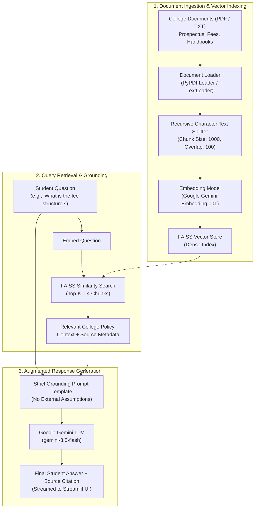

# 🎓 LLM-Based FAQ Chatbot for College Website

> An intelligent, document-grounded Retrieval-Augmented Generation (RAG) assistant designed for college websites to answer student, applicant, and parent queries strictly using official institutional documents.


---

## 📌 Problem Statement

Every academic year, college administrative offices, admission helplines, and department desks are overwhelmed with hundreds of repetitive inquiries regarding:
- Admission procedures and eligibility cutoffs
- Tuition fee breakdowns and refund rules
- Course offerings and branch specializations
- Examination timetables and minimum attendance criteria
- Campus placements and recruiters
- College working hours and campus facilities

Manual helplines are slow, static FAQ web pages are cumbersome to navigate, and traditional keyword search engines often fail to understand natural student questions. Furthermore, generic conversational AI models (like standard ChatGPT) hallucinate outdated or incorrect college policies because they lack access to the college's private documents.

---

## 🎯 Project Objective

To build a reliable, grounded, and conversational **College FAQ Chatbot** that:
1. Ingests official college PDFs and text documents (prospectuses, fee circulars, examination regulations, and student handbooks).
2. Extracts and indexes document information using dense vector representations (RAG architecture).
3. Accurately retrieves the most relevant college policy excerpts when a student asks a question.
4. Generates concise, factual, and student-friendly answers using Google Gemini.
5. **Prevents hallucinations**: If an answer is not present in the college documents, it clearly informs the student rather than guessing.
6. Cites the source document (and page number) for transparency.

---

## 🏗️ System Architecture & RAG Flow

The application strictly implements the **Retrieval-Augmented Generation (RAG)** pipeline:



### Detailed RAG Steps:
1. **Document Loading**: PyPDFLoader extracts text page by page from PDF handbooks; TextLoader parses unstructured TXT announcements.
2. **Chunking**: Text is segmented into chunks of 1,000 characters with 100 characters of overlap using `RecursiveCharacterTextSplitter`. Overlap ensures sentences and context are not cut mid-thought.
3. **Embeddings**: Each text chunk is converted into a 3072-dimensional dense numerical vector using `models/gemini-embedding-001`.
4. **FAISS Vector Store**: Vectors are indexed in memory using Facebook AI Similarity Search (FAISS) for sub-millisecond similarity lookups.
5. **Similarity Retrieval**: When a student asks a question, FAISS computes cosine/L2 similarity to retrieve the $k=4$ most relevant chunks.
6. **Strict Grounding Prompt**: Retrieved excerpts are injected into a prompt that instructs Gemini to base its answer **only** on the context. If information is missing, it responds with: *"I couldn't find this information in the available college documents."*
7. **Streaming Generation**: The response is streamed token-by-token directly to the Streamlit web interface with source citations.

---

## ✨ Key Features

- 🎓 **Purpose-Built for Colleges**: Designed specifically for admission inquiries, fee rules, courses, exams, and campus FAQs.
- 📁 **Multi-Format Document Support**: Upload any official college PDF or TXT file on the fly.
- 🏫 **Preloaded Sample Handbook**: Includes a complete sample handbook for *Apex Institute of Technology & Science (AITS)* covering admissions, 92% placement rates, fee tiers, and rules for immediate testing and viva evaluation.
- 💡 **One-Click Suggested Questions**: Instant buttons for common inquiries (admission process, eligibility, fees, placement stats, timings).
- 🛡️ **Zero Hallucination Guarantee**: Strict prompt engineering ensures the AI never invents dates, fees, or course rules.
- 📄 **Source Document Citations**: Shows the exact document and page number used to answer each query.
- 🔄 **Real-Time Streaming**: Responsive chat interface with token-by-token streaming indicators.
- 📥 **Export Chat Transcript**: Download the entire conversation log for future reference.

---

## 🛠️ Tech Stack

| Component | Technology | Role |
| :--- | :--- | :--- |
| **User Interface** | Streamlit | Responsive, interactive college chat portal |
| **Orchestration** | LangChain | RAG pipeline, prompt formatting, document splitting |
| **Embedding Model** | Google Gemini (`gemini-embedding-001`) | High-dimensional semantic text embeddings |
| **Vector Database** | FAISS (CPU) | Fast similarity search and indexing |
| **Generative LLM** | Google Gemini (`gemini-3.5-flash`) | Context-grounded response synthesis |
| **Document Loaders** | `pypdf`, `langchain-community` | Text extraction from PDF prospectus and TXT files |
| **Environment** | Python 3.11+, `python-dotenv`, `uv` | Dependency isolation and secrets management |

---

## 📋 Prerequisites

- **Python**: Version 3.11 or higher
- **Google Gemini API Key**: [Get a free API key from Google AI Studio](https://aistudio.google.com/app/apikey)

---

## 🚀 Installation & Setup

### 1. Clone the Repository
```bash
git clone https://github.com/pranay498/Document_Based_QA_System.git
cd Document_Based_QA_System
```

### 2. Configure Environment Variables
Copy `.env.example` to `.env` and insert your Gemini API Key:
```bash
cp .env.example .env
```
Inside `.env`:
```env
GOOGLE_API_KEY=your_actual_gemini_api_key_here
```

### 3. Install Dependencies
Using **`uv`** (recommended):
```bash
uv sync
```
*Or using traditional `pip`:*
```bash
python3 -m venv .venv
source .venv/bin/activate
pip install -r requirements.txt
```

---

## 🖥️ Running the Application

Using **`uv`**:
```bash
uv run streamlit run app.py
```

*Or inside an activated virtual environment:*
```bash
source .venv/bin/activate
streamlit run app.py
```

Open your browser and navigate to:
```
http://localhost:8501
```

---

## 💬 Example Questions to Try

| Category | Example Question |
| :--- | :--- |
| **Admissions** | *"What is the step-by-step admission process?"* |
| **Eligibility** | *"What is the eligibility criteria for B.Tech and BCA programs?"* |
| **Fees** | *"What is the annual fee structure for B.Tech CSE and MBA?"* |
| **Courses** | *"What undergraduate and postgraduate courses are offered?"* |
| **Documents** | *"What mandatory documents are required during admission verification?"* |
| **Placements** | *"What was the highest and average package in recent placements?"* |
| **Examinations** | *"When do the odd semester examinations start, and what is the minimum attendance required?"* |
| **Timings** | *"What are the working hours of the college and central library?"* |
| **Out-of-Scope (Test Fallback)** | *"What is the swimming pool timing?"* → *(Bot responds: "I couldn't find this information in the available college documents.")* |

---

## 🎓 Viva & Project Presentation Guide

If presenting this project for an academic viva or evaluation, here are key theoretical concepts to highlight:

1. **Why RAG instead of Fine-Tuning?**
   - Fine-tuning embeds knowledge into model weights, which is expensive, slow, and prone to hallucinations when college policies change.
   - RAG keeps model weights fixed and dynamically injects the latest college documents as context into the prompt, making it easy to update policies simply by uploading a new PDF.

2. **What is Chunking and Why is it Necessary?**
   - LLMs have context limits, and embedding an entire 50-page college prospectus into a single vector dilutes semantic specificity.
   - We divide text into 1,000-character chunks with 100-character overlap using `RecursiveCharacterTextSplitter`. Overlap prevents critical information from being split across chunk boundaries.

3. **How does FAISS Similarity Search Work?**
   - FAISS converts the user's question into an embedding and calculates cosine similarity / Euclidean distance against indexed chunk vectors to return the top-$k$ closest excerpts.

4. **How are Hallucinations Prevented?**
   - Strict system prompt constraints.
   - Setting `temperature = 0.2` to minimize creative liberties.
   - Hardcoded negative constraint: *"If the information is not in the context, say 'I couldn't find this information in the available college documents.'"*

---

## ⚠️ Limitations

- **Image-only PDFs**: Scanned PDF pages without an OCR text layer cannot be parsed by `PyPDFLoader` unless an OCR tool (e.g., Tesseract) is integrated.
- **In-Memory Vector Store**: The current FAISS index resides in memory during the Streamlit session. A new server restart requires re-indexing the document (or saving FAISS index to disk).
- **Tabular Data**: Extremely complex multi-page tables may require specialized table extractors.

---

## 🔮 Future Improvements

- [ ] **Multi-Document Ingestion**: Support indexing multiple separate files simultaneously (e.g., Syllabus + Fee Structure + Placement Report in one unified vector store).
- [ ] **Persistent Vector Storage**: Store FAISS index or ChromaDB vectors locally on disk between restarts.
- [ ] **Multilingual Support**: Support Hindi and regional languages for parents and students.
- [ ] **Voice Query Support**: Voice-to-text input using Whisper or Gemini Live API for accessible student inquiries.

---

## 📜 License

This project is licensed under the [MIT License](LICENSE).
